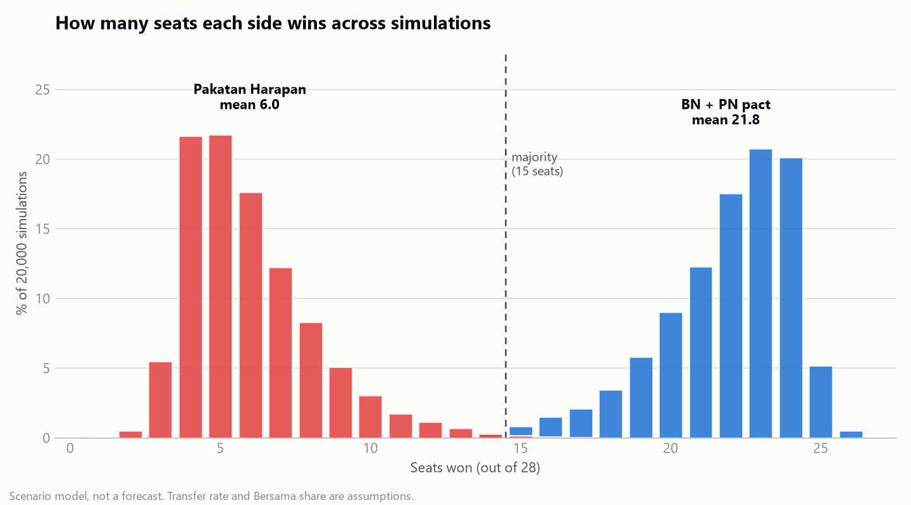
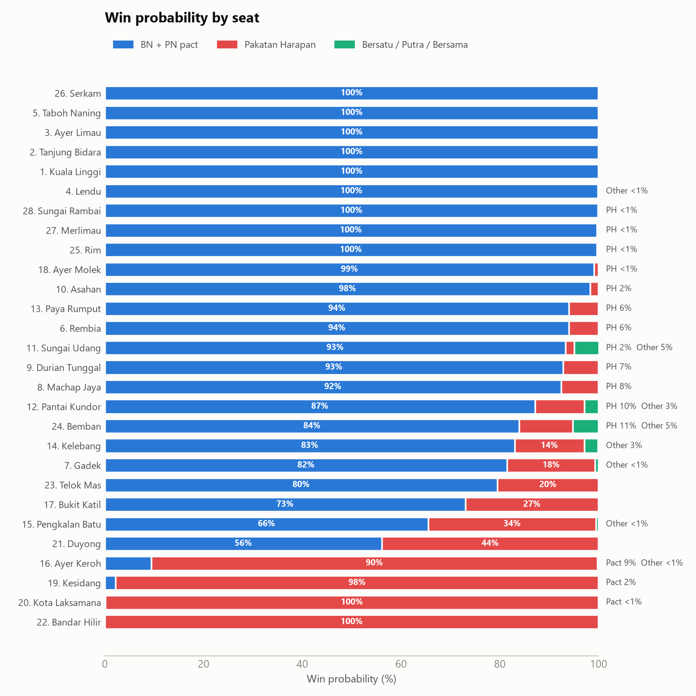

# Melaka PRN 2026 seat simulation

A small Python project that simulates the 2026 Melaka state election (28 seats,
polling day 14 Nov 2026). It estimates, for each seat, the chance that each side wins,
and the spread of total seats across 20,000 simulated elections.

> **This is a scenario model, not a reliable forecast.** There are only three past
> state elections to learn from, and the backtest was weak (see [Limitations](#limitations)).
> Treat the output as "what happens under these assumptions", not "what will happen".

## Results

| Bloc | Mean seats | 80% range | Chance of 15+ seats |
|---|---|---|---|
| BN + PN pact | 21.8 | 19–24 | 99% |
| Pakatan Harapan | 6.0 | 4–9 | under 1% |
| Bersatu / Putra | 0.2 | 0–1 | 0% |
| Bersama | ~0 | 0 | 0% |

The 99% figure is overconfident; the model understates how much seats can swing.
Close seats: Duyong, Pengkalan Batu, Bukit Katil, Telok Mas.





The charts are regenerated by `python src/charts.py` and saved in `reports/`.

## How it works

The pipeline has four steps. Run them from the project root.

```
python -m pip install -r requirements.txt

python src/fetch_data.py   # 1. download raw results (Tindak Malaysia, GitHub)
python src/features.py     # 2. build one row per seat: vote shares 2013/2018/2021, demographics, GE15
python src/model.py        # 3. backtest a ridge model (evidence only; not used by step 4)
python src/simulate.py     # 4. Monte Carlo simulation of the 2026 election
python src/charts.py       # 5. draw the charts in reports/
```

### The simulation (`src/simulate.py`)

Four blocs compete: the **BN+PN pact**, **PH**, **Bersatu/Putra** (outside the pact)
and **Bersama** (new, contests alone). BN and PN never face each other in 2026,
so they are treated as one candidate per seat.

Each of the 20,000 runs:

1. Starts from 2021 vote shares, moved 40% of the way toward GE15 (2022) shares.
2. Draws a state-wide **BN↔PN transfer rate** (mean 80%) and the share of 2021 PN
   voters who follow Bersatu/Putra where it stands (mean 50%).
3. Builds each bloc's share, adds a state-wide swing and seat-level noise, and
   removes blocs that have no candidate in that seat.
4. Gives Bersama about 8% where it stands (more if votes fail to transfer), and 1% to an independent.
5. The highest share wins the seat.

All of these numbers live in `PARAMS` at the top of `simulate.py`, so changing an
assumption and rerunning takes seconds.

## Files

| Path | What it is |
|---|---|
| `src/fetch_data.py` | Downloads the raw CSVs into `data/raw/tindak/` |
| `src/features.py` | Cleans and merges them into `data/processed/seats_features.csv` |
| `src/model.py` | Backtests a ridge model against a "no change" baseline → `backtest.json` |
| `src/simulate.py` | The simulation → `seat_probabilities_2026.csv`, `seat_totals_sims_2026.csv` |
| `src/charts.py` | Charts → `reports/*.png` |
| `data/processed/lineup_2026.csv` | 2026 candidate list: one row per candidate (seat, party) |

## Data sources

- **Historical results (2013, 2018, 2021 state; 2022 general election)** and 2021 voter demographics:
  [Tindak Malaysia, HISTORICAL-ELECTION-RESULTS](https://github.com/TindakMalaysia/HISTORICAL-ELECTION-RESULTS).
  Check that repository for licence and attribution terms before reusing the data.
- **2026 candidate list**: transcribed by hand from
  [Kosmo's nomination-day list](https://www.kosmo.com.my/2026/10/31/senarai-calon-bertanding-prn-melaka-ke-16/).
  It has **not** been checked against the Election Commission (SPR) list or a second source.
  The code checks that party counts match the reported totals (79 candidates: BN 23, PH 24, Bersama 16, Bersatu 7, PN 5, Putra 1, independents 3).

## Limitations

- **The backtest is weak.** A ridge model trained on one election transition did not
  reliably beat assuming nothing changes. Even that baseline picks the right seat winner only
  ~60–68% of the time, with 11–17 percentage point errors in vote share. So the simulation
  uses a swing approach and judgement-based parameters instead of fitted ones.
- **Assumptions are guesses.** The 80% transfer rate, 50% Bersatu retention, Bersama's 8%,
  the noise sizes and the 40% GE15 weight have no historical support.
- **Pact votes are probably inflated.** Votes that fail to transfer are partly rescaled back
  into the shares instead of leaving the pact entirely, so the pact's effective transfer
  is above the stated 80%.
- **Missing context.** Turnout, campaign events, candidate quality, Bersatu–PH
  relations and early-voting numbers are not modelled. GE15 results exist only per parliament
  seat (6 in Melaka), so each state seat inherits its parliament seat's share.
- **Possible boundary and lineup differences** between 2021 and 2026 are not handled.
